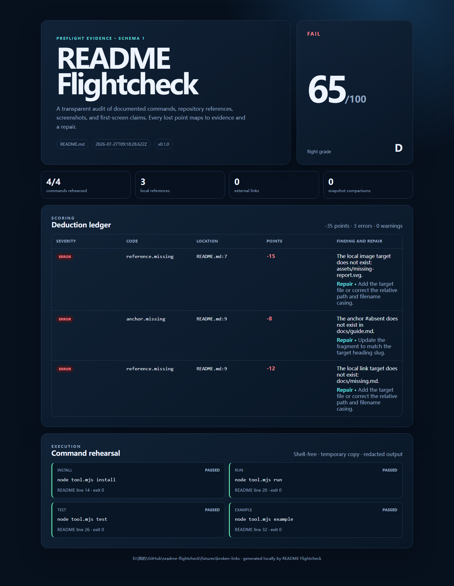

# README Flightcheck

[](https://github.com/KanadeK/readme-flightcheck/actions/workflows/ci.yml)
[](https://github.com/KanadeK/readme-flightcheck/releases)
[](LICENSE)

[English](README.md) | 简体中文

README Flightcheck 是面向仓库 README 承诺的本地优先“起飞前检查”。它会解析安装、运行、测试和示例命令；在一次性副本中演练安全命令；检查链接、图片、徽章与锚点；最后给出带证据和修复建议的透明评分。



- 不经过 shell、不触碰工作目录地演练 README 命令。
- 每一分扣分都能回溯到文件、行号、命令结果或快照。
- CLI 与 GitHub Action 使用同一个审计引擎。

**当前状态：** v0.1.0。需要 Node.js 22 或 24，以及 npm 11。

## 快速开始

```sh
npx readme-flightcheck audit . --execute
```

也可以在当前检出中对随仓库提交的健康 fixture 运行：

```sh
npm ci
npm run build
node dist/cli.js audit fixtures/healthy --execute --format json
```

健康 fixture 会得到 `100 / A`，其中四条文档命令都会在临时副本中真实执行。`broken-links` fixture 则会得到真实的 `65 / D`：它包含缺失图片、缺失链接和过期锚点。

## 检查内容

| README 声明                  | 可核验证据                                        |
| ---------------------------- | ------------------------------------------------- |
| 安装、运行、测试、示例代码块 | 解析后的命令、章节、README 行号、退出码、脱敏输出 |
| 相对链接、图片、徽章、锚点   | 根目录约束、目标文件内容、GitHub 兼容标题 slug    |
| 外部 HTTP(S) 链接            | 可选、具 SSRF 防护的 HEAD/GET 检查与重定向上限    |
| 渲染后的页面快照             | 可选 Playwright PNG 截图与像素比较                |
| README 结构                  | 缺失章节、缺失命令与首屏信息证据                  |

## CLI

```text
readme-flightcheck audit [repository] [options]

--execute                       演练允许列表中的 README 命令
--allow-command <command>       额外精确批准一条命令
--check-external                向目标地址检查 HTTP(S) 链接
--page-url <url>                截取渲染页面
--snapshot-output <path>        写入最新 PNG 快照
--baseline <path>               与 PNG 基线比较
--format terminal|json|markdown|html|github
--output <path>                 写入所选格式的报告
--fail-below <score>            低于分数时返回 exit 1（默认 80）
```

### 完整本地示例

```sh
node dist/cli.js audit fixtures/broken-links --execute --format html --output media/broken-links-report.html
```

打开 `media/broken-links-report.html` 即可查看响应式报告；其中列出三项扣分和四条实际运行的命令。`npm run demo` 会从提交的 fixture 重新生成这份 HTML、JSON 和本文截图。

### GitHub Action

```yaml
- uses: KanadeK/readme-flightcheck@v0.1.0
  with:
    execute: true
    fail-below: 80
    report-path: readme-flightcheck-report.json
```

Action 会输出行内注释、Step Summary、`score`、`grade`、`passed` 与 `report-path`。如需留存 JSON，请在工作流中按常规方式上传为 artifact。

## 隐私与安全边界

默认审计仅在本地只读执行。命令演练必须显式开启，且不经过 shell、受文档化允许列表约束、在唯一临时副本中运行、拥有超时限制，并会对常见凭据进行脱敏。外部链接检查和浏览器快照同样需要显式开启，因为它们会访问 URL 或渲染页面。私网、回环、携带凭据和不支持协议的外部地址默认会被阻止。

详细威胁模型见[隐私与安全](docs/PRIVACY_AND_SECURITY.md)。通过审计仅说明 README 声明具备所列证据，不能替代依赖审查、密钥扫描或人工安全评估。

## 架构

```text
CLI / GitHub Action
        |
应用编排
        |
核心规则 <---- 适配器：文件、命令、HTTP、浏览器
        |
报告器：终端、JSON、Markdown、HTML、GitHub 注释
```

核心模块是确定性的，不依赖 Commander、Playwright、网络或进程执行。适配器被隔离在边缘，报告器读取同一份经过校验的审计报告。详情见[架构](docs/ARCHITECTURE.md)。

## Fixture 与测试

仓库提交了四个 MIT 许可、可离线复现的 fixture：

| Fixture                  | 预期评分 | 目的                                     |
| ------------------------ | -------: | ---------------------------------------- |
| `fixtures/healthy`       |  100 / A | 成功的命令演练与有效引用                 |
| `fixtures/stale-command` |   75 / C | 真实失败的安装命令（`MODULE_NOT_FOUND`） |
| `fixtures/broken-links`  |   65 / D | 缺失图片、相对链接和锚点                 |
| `fixtures/hollow-readme` |   32 / F | 缺失 README 结构与可执行声明             |

```sh
npm run verify
npm run test:coverage
npm run test:e2e
npm run build
```

测试覆盖解析与评分规则、真实临时仓库、确定性 HTTP fixture server、Playwright 快照比较、CLI 进程、打包后的 Action 输出、无障碍、键盘操作和 390px 报告布局。覆盖率门禁要求全局行覆盖率不低于 80%，核心模块不低于 90%。

## 非目标

- 执行任意 README shell 片段。
- 宣称一个项目安全、被维护或可以直接用于生产。
- 替代被审计项目完整的浏览器或集成测试。
- 默认收集使用数据，或默认发送仓库内容。

## 与相邻工具的差异

公开仓库抽样中可以找到 README lint、链接检查与评分卡工具。README Flightcheck 将这些静态证据与隔离命令演练、可选渲染快照比较、透明扣分账本和 Action 注释结合起来。[竞品扫描](docs/COMPETITOR_SCAN.md)记录了抽样方式和项目边界。

## 路线图

- 为团队共享的命令策略增加配置文件支持。
- 增加用于人工视觉审查的基线管理命令。
- 为代码扫描流水线增加可选 SARIF 输出。

## 常见问题

**`--execute` 会运行 `npm install` 吗？** 默认策略只允许带 `--ignore-scripts` 的 `npm ci`，且它在一次性副本中执行；其他命令必须精确显式批准。

**`--check-external` 会扫描我的内网服务吗？** 不会。私网与回环地址会被阻止；只有可信 fixture 才应显式传入 `--allow-private-hosts`。

**离线能用吗？** 可以。解析、本地引用检查、命令演练和四个 fixture 都可离线运行；外部链接与页面 URL 是可选适配器。

## 贡献

请先阅读 [CONTRIBUTING.md](CONTRIBUTING.md)，使用 Issue Forms，并让每项改动拥有真实 fixture 或回归测试。安全问题请按 [SECURITY.md](SECURITY.md) 私下报告，不要公开提交 Issue。

## 许可

[MIT](LICENSE)
