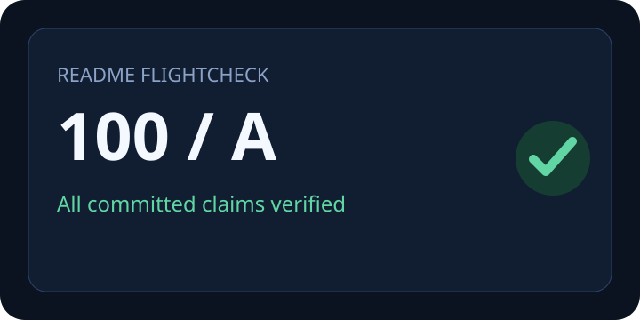

# Healthy Airframe

A local-first sample proving that installation, usage, tests, and examples are reproducible. Status: v0.1.0. It reads no secrets, uses no network, and keeps its privacy and security boundary inside this fixture.

[](https://example.test/actions)



Read the [usage guide](docs/guide.md#usage).

## Installation

```sh
node scripts/install-check.mjs
```

## Usage

```sh
node app.mjs --name Maintainer
```

## Tests

```sh
node test.mjs
```

## Example

```sh
node app.mjs --name Flightcheck
```
