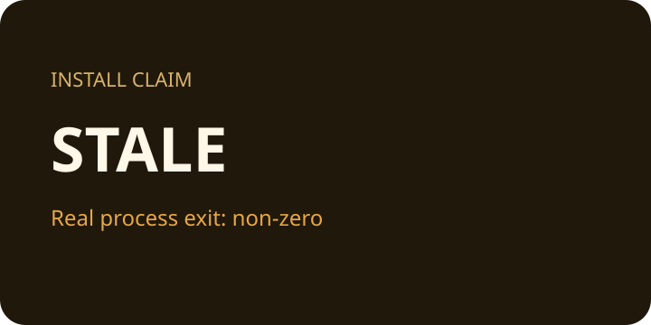

# Stale Install Airframe

This local-only sample has complete usage, test, example, status v0.1.0, privacy, and security documentation, but its historical installation command no longer points to a real script.

[](https://example.test/actions)



Read the [usage guide](docs/guide.md#usage).

## Installation

```sh
node scripts/install-v1.mjs
```

## Usage

```sh
node tool.mjs run
```

## Tests

```sh
node tool.mjs test
```

## Example

```sh
node tool.mjs example
```
